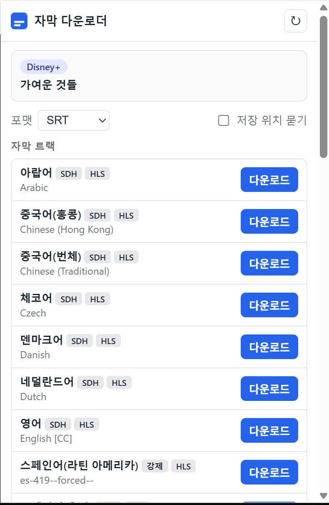

# subtitles_downloader

YouTube, Netflix, Disney+ 및 일반 사이트의 자막을 SRT / WebVTT / ASS / TXT / 원본 포맷으로 저장하는 크롬 확장 프로그램. Manifest V3, 빌드 도구 없이 순수 JavaScript로 작성됨.

| 항목 | 내용 |
| --- | --- |
| 버전 | 1.0.0 |
| 최소 Chrome | 116 |
| 의존성 | 없음 (테스트는 Node 18+ 내장 `node --test`) |



## 설치

1. `chrome://extensions` 접속 후 우측 상단 **개발자 모드** 활성화
2. **압축해제된 확장 프로그램을 로드합니다** 클릭 → 이 디렉토리 선택
3. 설치 전에 열려 있던 플랫폼 탭은 새로고침 필요

## 사용법

1. 지원 플랫폼에서 영상을 재생 (자막 목록은 플레이어가 매니페스트를 요청하는 시점에 수집됨)
2. 툴바 아이콘 클릭 → 포맷 선택 → 원하는 언어 트랙의 **다운로드** 클릭
3. 파일은 기본 다운로드 폴더에 `<제목>.srt` (시리즈는 `<제목> S01E02.srt`) 이름으로 저장됨
4. 같은 영상의 다른 언어를 이어서 받으면 Chrome이 `<제목> (1).srt`처럼 번호를 붙임

팝업 옵션
- **포맷**: SRT, WebVTT, ASS, TXT, 원본(플랫폼이 제공한 파일 그대로)
- **저장 위치 묻기**: 켜면 매번 저장 대화상자가 열림
- **새로고침**: 트랙 목록을 다시 요청함

### YouTube 자동 번역

YouTube 페이지에서는 원본 트랙을 기반으로 YouTube 서버 번역(tlang) 자막을 원하는 언어로 받을 수 있음. 팝업의 **자동 번역** 항목에서 언어를 고르고 다운로드.

### 일반 사이트 (범용 감지)

팝업의 **모든 사이트에서 감지 켜기**를 누르면 `<all_urls>` 선택 권한을 요청함. 허용 후 페이지를 새로고침하면 웹 플레이어가 불러오는 자막 파일(srt, vtt, ttml, xml 등)과 HLS(m3u8) / DASH(mpd) 자막 트랙이 자동 감지되어 팝업에 표시됨. 권한은 같은 버튼으로 언제든 해제 가능.

## 지원 플랫폼과 동작 원리

| 플랫폼 | 상태 | 트랙 수집 방식 (MAIN world 인젝터) | 자막 원본 포맷 |
| --- | --- | --- | --- |
| YouTube | 검증 완료 | InnerTube `player` API(ANDROID 클라이언트)로 captionTracks 조회, `timedtext?fmt=json3` | json3 |
| Netflix | 검증 완료 | `JSON.parse` 후킹으로 manifest의 `timedtexttracks.ttDownloadables` URL 수집, 플레이어 API로 트랙 목록 구성. URL이 없는 트랙은 활성화 후 폴링하고, 그래도 없으면 백그라운드가 관찰한 자막 파일 요청(`nflxvideo.net/?o=`)을 사용 | WebVTT / DFXP(TTML) |
| Disney+ | 검증 완료 | `JSON.parse` / `Response.json` / fetch 후킹으로 마스터 m3u8 감지 → `#EXT-X-MEDIA:TYPE=SUBTITLES` 파싱. 백그라운드 webRequest 폴백 병행 | HLS WebVTT 세그먼트 |
| 일반 사이트 | 구현 완료 | 백그라운드 `webRequest.onCompleted`로 자막 파일 / m3u8 / mpd 요청 감지 | 자동 판별 |
| HBO Max | 비활성 | DASH MPD 파싱(광고 Period 제외, 텍스트 AdaptationSet 세그먼트 목록). 백그라운드 webRequest 폴백 병행 | WebVTT / TTML 세그먼트 |
| Prime Video | 비활성 | `GetVodPlaybackResources` 응답의 `subtitleUrls` / `forcedNarrativeUrls` | TTML2 |
| Apple TV+ | 비활성 | `play-edge.itunes.apple.com` 마스터 플레이리스트 파싱, 광고/프리롤 블록 제외 | HLS WebVTT 세그먼트 |

HBO Max, Prime Video, Apple TV+는 계정 미보유로 검증하지 못해 비활성 상태임. 인젝터 코드(`src/injectors/hbomax.js`, `primevideo.js`, `appletv.js`)는 남아 있으며, 활성화하려면 `src/shared/platforms.js`의 `enabled`를 `true`로 바꾸고 manifest의 `host_permissions`와 `content_scripts`에 해당 도메인/인젝터를 추가하면 됨. 활성화 시 필요한 값은 아래와 같음.

| 플랫폼 | host_permissions | MAIN world content_scripts js |
| --- | --- | --- |
| HBO Max | `*://play.hbomax.com/*`, `*://play.max.com/*`, `*://*.hbomax.com/*`, `*://*.max.com/*`, `*://*.discomax.com/*` | `_common.js`, `src/shared/dash.js`, `hbomax.js` |
| Prime Video | `*://*.primevideo.com/*`, `*://*.pv-cdn.net/*`, `*://*.aiv-cdn.net/*`, `*://*.aiv-delivery.net/*`, amazon 각국 도메인 | `_common.js`, `primevideo.js` |
| Apple TV+ | `*://tv.apple.com/*`, `*://*.tv.apple.com/*`, `*://*.itunes.apple.com/*` | `_common.js`, `src/shared/hls.js`, `appletv.js` |

모든 원본 포맷은 공통 큐 모델(`{start, end, text}`)로 파싱된 뒤 선택한 출력 포맷으로 직렬화됨. 파서는 DOM API를 쓰지 않으므로 서비스 워커와 Node 테스트에서 같은 코드를 사용함.

## 디렉토리 구조

```
manifest.json
package.json                     npm test / npm run icons
_locales/{en,ko}/messages.json   UI 문자열
icons/                           아이콘 (scripts/make-icons.js로 생성)
scripts/make-icons.js            의존성 없는 PNG 아이콘 생성기
src/shared/formats.js            자막 포맷 파서/직렬화기 (VTT, SRT, TTML/DFXP, srv1/srv3/json3, SBV, ASS, SAMI)
src/shared/hls.js                m3u8 마스터/미디어 플레이리스트 파서
src/shared/dash.js               MPD 텍스트 트랙 파서
src/shared/filename.js           저장 파일명 생성 (서비스 접미사 제거 포함)
src/shared/platforms.js          플랫폼 정의 및 URL 판별 (enabled 플래그)
src/injectors/_common.js         MAIN world 공용 훅 헬퍼 (fetch/XHR/JSON.parse/Response.json, postMessage)
src/injectors/<platform>.js      플랫폼별 트랙 수집 인젝터
src/content/content-script.js    ISOLATED world: 인젝터 ↔ 팝업 중계, 다운로드 파이프라인, 파일 저장
src/background/service-worker.js 프록시 fetch, downloads API 저장, 네이티브 폴백 및 범용 감지
src/popup/                       팝업 UI
test/                            Node 유닛 테스트
```

## 메시지 흐름

```
인젝터(MAIN) --postMessage(TRACKS, VIDEO_INFO)--> 콘텐츠 스크립트(ISOLATED)
팝업 --GET_STATE / DOWNLOAD--> 콘텐츠 스크립트 --PROXY_FETCH--> 서비스 워커
서비스 워커 --FALLBACK_TRACKS / NETFLIX_SUBTITLE_REQUEST--> 콘텐츠 스크립트 (webRequest 폴백)
팝업 --GET_UNIVERSAL_STATE / DOWNLOAD_UNIVERSAL--> 서비스 워커 (일반 사이트)
```

파일 저장은 플랫폼 페이지에서는 콘텐츠 스크립트가 Blob + `<a download>`로 수행함. MV3 서비스 워커의 `chrome.downloads.download`(data URL)는 파일명이 무시되는 경우가 있어, 백그라운드 경로("저장 위치 묻기", 일반 사이트)에서는 `onDeterminingFilename`으로 파일명을 다시 제안함.

## 개발

```bash
npm test          # 유닛 테스트 (node --test)
npm run icons     # 아이콘 재생성
```

문제 진단 시 재생 페이지 콘솔(F12)에서 `subtitles_downloader`로 필터하면 트랙 수신, URL 해석, 저장 단계 로그를 볼 수 있음. 백그라운드 로그는 `chrome://extensions`의 서비스 워커 콘솔에서 확인.

## 제한 사항

- DRM 콘텐츠의 영상/음성은 다루지 않으며 자막 텍스트 트랙만 저장함
- 플랫폼의 내부 API 구조가 바뀌면 해당 인젝터 수정 필요
- fMP4(wvtt/stpp) 컨테이너에 담긴 자막은 지원하지 않음
- Netflix의 `simplesdh` 전용 XML 포맷은 자동 판별 대상이 아니며, 다른 프로필(WebVTT, DFXP)이 우선 선택됨
